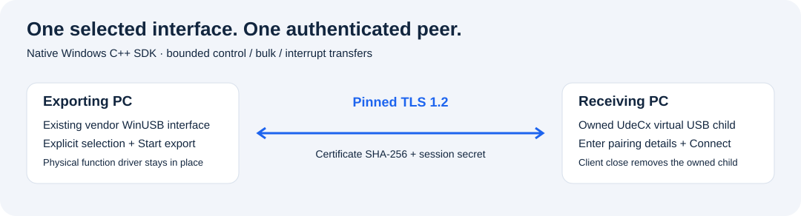

# USB-over-IP SDK - Windows Kernel USB Device Bridge

**Share one explicitly selected WinUSB interface through an authenticated, encrypted connection and expose it as an owned Windows virtual USB device.**

The native C++ SDK connects an existing WinUSB exporter to a private UdeCx virtual
controller. Both IN and OUT transfers remain pending until the remote operation
completes. The same installed driver supports a one-hour demo and product-key
activation through `Verification(key)`.



**Windows 10 version 2004/build 19041+ or Windows 11, x64 only.** This is an
engineering evaluation. Application, SDK, examples and installer
source are public; kernel implementation stays private. The complete release includes the returned Microsoft-signed
runtime/controller packages and both self-contained installers. The labelled `--preview` opens no USB interface, runtime or
network listener. See [validation](docs/VALIDATION.md) for actual test scope.

## Initial supported scope

| Capability | Boundary |
| --- | --- |
| Physical exporter | One exact, present interface already using Microsoft's WinUSB driver. |
| USB topology | USB 2 full/high speed, one configuration, vendor-specific interface 0, alternate setting 0, up to eight bulk/interrupt endpoints. |
| Transfers | Vendor/class control and bulk/interrupt IN/OUT, at most 4,096 bytes per transfer and 32 pending requests. |
| Virtual client | One owner-scoped UdeCx device; closing the client removes that owned child. |
| Transport | Numeric IPv4 TCP, TLS 1.2, exact SHA-256 certificate pin and a separate random 128-bit session secret. |
| Recovery | Bounded request timeout, cancellation propagation and explicit Stop/reconnect. |

This edition is a **WinUSB integration bridge**, not universal redirection of
arbitrary USB hardware. HID keyboard/mouse, storage-class, composite, alternate
settings, hubs, USB 3, isochronous audio/video and physical endpoint-reset
forwarding are outside its supported scope. Devices are not silently rebound
from another driver to WinUSB. The client uses an inbox WinUSB interface with
GUID `{ED329644-7E18-44D6-83C2-052C217393A7}`; existing applications expecting a
different interface GUID need integration. Microsoft OS descriptor vendor code
`0x5b`, indices 4/5, is reserved for that virtual interface's discovery metadata.
Original firmware data is otherwise forwarded through the bounded supported API.

The encrypted wire protocol is specific to this SDK. It is not compatible with
Linux USB/IP, VirtualHere or other vendors' transports. Network and USB scheduling
still affect timing; no physical-bus timing or zero-latency equivalence is claimed.

The release ZIP contains the application, CLI, example, both single-file setup
executables and matching opaque Microsoft-signed packages under `Driver/`.
Microsoft signing covers the driver packages; the user-mode EXEs are separate.
The supported scope and executed qualification are documented in
[validation](docs/VALIDATION.md).

## Install and use

1. Extract the [complete project ZIP](https://github.com/titanfyre/USB-over-IP-SDK/releases).
   Run `USBOverIPStudio.exe --preview` for a labelled offline view.
2. With a qualified Microsoft-signed bundle, run `USBOverIPSetup.exe` as
   administrator on both PCs and choose **Install / reinstall**. The single EXE
   embeds the shared Titan SDK Runtime and this product's virtual controller.
   Restart Windows only when requested. Source builds without signed payloads
   refuse installation.
3. On the exporting PC, choose a supported interface. Use `127.0.0.1` for a local
   test, or enter that PC's exact LAN IPv4 address. Choose **Start export**.
4. Give only the intended recipient the displayed IPv4 address, port, certificate
   SHA-256 and session secret through a trusted channel. The session secret and
   certificate identity change when a new export is started.
5. On the receiving PC, enter those details and choose **Connect**. The virtual
   child is created only after certificate pinning and peer authentication.
6. Use the virtual child's WinUSB interface from your application. **Disconnect**
   or closing the client removes the owned child; **Stop export** releases the
   physical WinUSB interface. Re-exporting this SDK's own virtual child is refused.

The exporter binds only to the address you specify and accepts one peer. No
firewall rule, certificate trust store, physical-device driver or background
remote-access service is modified. A Windows firewall permission may need to be
configured by the PC's administrator for an explicitly chosen LAN deployment.

```powershell
USBOverIPCLI.exe devices
USBOverIPCLI.exe export "exact WinUSB interface path" 192.168.1.60 28419
USBOverIPCLI.exe connect 192.168.1.60 28419 SHA256_PIN SESSION_SECRET
USBOverIPSetupConsole.exe /install
USBOverIPSetupConsole.exe /uninstall
```

Close active SDK applications before uninstalling. The product uninstaller
removes only its own controller/package. The shared runtime is retained because
other Titan SDK products may use it. An exit code of `3010` requests a manual
Windows restart; setup does not restart Windows automatically.

## Minimal C++ use

Compile the sources in `SDK/` with C++17; the supplied CMake project links the
native Windows dependencies. Sizes, handles and worker lifetimes are managed by
the SDK.

When combining Titan SDKs in one app, compile one copy of the shared `License.cpp`.
For Remote Workstation and USB-over-IP together, also compile only one shared `Transport.cpp`.

```cpp
#include "USBOverIP.h"

UsbIp::Exporter exporter;
auto pairing = exporter.Start(selectedInterfacePath, "192.168.1.60", 28419);
// Display pairing to the intended recipient; keep exporter alive.
```

On the receiving computer:

```cpp
#include "USBOverIP.h"

UsbIp::Client device;
device.Connect(pairing);
// Use the virtual WinUSB child while device remains alive.
```

`GetStatus()` returns active/connected state, completed/failed counts and an
English detail. Creation/connection errors throw `std::runtime_error`.
Lifecycle operations are serialized on each SDK object; data workers have bounded
queues and per-endpoint ordering. `Stop()` is idempotent. Treat physical operations
as ordinary asynchronous USB operations: cancellation cannot undo a write already
performed by the device.

## Demo and full activation

The shared kernel runtime records the first real use of product 9. Its one-hour
deadline is shared across processes for that Windows boot. Closing an app,
reopening a client or reloading the function driver does not restart the demo.
On expiry, new operations are refused and active sessions stop safely.

```cpp
#include <iostream>
auto error = UsbIp::Verification("YOUR_PURCHASED_PRODUCT_KEY");
if (!error.empty()) std::cerr << error << '\n';
```

Call this on each participating PC to activate the full product for its current
boot. The server returns a fresh, signed, product-specific permission; its
private signing key never reaches the application. The same demo driver verifies
the permission through its referenced kernel runtime and removes the one-hour
cutoff. No replacement full-driver binary or app-side boolean is used.

Windows restart returns the product to demo mode until `Verification(key)` is
called again. Revoking a key prevents future activation; it does not immediately
cancel a permission already accepted for the current boot. Keys have no TPM or
machine binding. Public user-mode code cannot manufacture a signed kernel
permission, but Microsoft WinUSB APIs themselves are not private to this SDK.

For a **full key, paid integration pilot, OEM redistribution or maintenance**, add
**`titancsa` on Discord** and specify Windows versions, USB interface topology and
the intended deployment. Compatibility and acceptance tests are agreed for the
integration. No automatic payment collection is included.

## Build

Visual Studio 2022 Desktop C++, CMake and a Windows SDK are sufficient for the
public application/SDK. A WDK is needed only for the private driver project.

```powershell
.\Build.ps1
.\Build.ps1 -Asan
# Rebuild setup with both opaque signed packages from the release ZIP:
.\Build.ps1 -RuntimePackageDirectory .\Driver\TitanSdkRuntime `
            -DriverPackageDirectory .\Driver\TitanUSBOverIP
```

Outputs are in `obj/Build/bin/Release`. Kernel sources, CABs, PDBs, private lab
tools, activation keys and signing material are excluded from the public repo.
Public application/SDK/example/installer source is [MIT licensed](LICENSE);
private driver binaries have separate evaluation/OEM terms.

Use only on systems and devices you own or are authorized to administer. You are
responsible for lawful use, device-data handling and protection of pairing/key
material. No unlawful use is endorsed. Software is supplied without warranty,
subject to its licenses and mandatory statutory rights.
